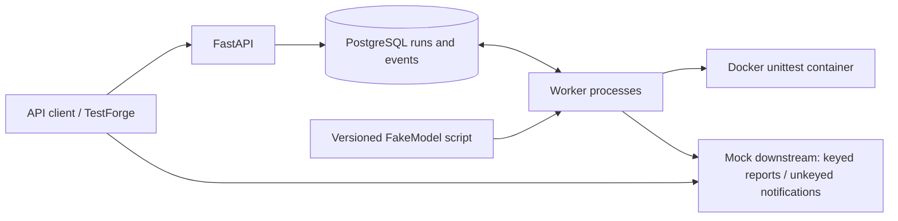

# AgentForge

A durable agent-workflow runtime built with Python, FastAPI and PostgreSQL.
Workers claim queued runs, save decisions before executing tools, and resume work after
worker crashes. A scripted `FakeModel` makes recovery behavior reproducible without an
LLM API key.

**Current scope:** a local portfolio runtime with real PostgreSQL coordination, Docker
execution, recovery drills and an isolated target for [TestForge](docs/TESTFORGE.md).
The AWS stack is an [optional deployment demonstration](infra/README.md).

## What it demonstrates

- **Durable execution:** decisions, tool intents, results and events are persisted in PostgreSQL.
- **Concurrent workers:** `FOR UPDATE SKIP LOCKED` claims, renewable leases and generation
  fencing prevent stale owners from committing results.
- **Recovery semantics:** read-only tools can run again; keyed effects reuse their idempotency
  key; an uncertain unkeyed effect ends with `UNKNOWN_EFFECT` rather than being sent again.
- **Failure evidence:** repeatable worker-kill, stale-worker and poison-run drills, plus ordered
  run events and an inspectable downstream report.

Execution is **at least once**. A keyed report is applied once only while the downstream
service retains its idempotency record. The included `mock_effects` service keeps that
record in memory: restarting it loses reports and deduplication state. AgentForge does
not promise exactly-once execution or recovery from every kind of failure.

## Architecture



The API queues runs; workers execute them. A worker records the decision, records the tool
intent, performs the tool call, then commits the result/checkpoint. Each database write is
fenced by the active lease generation. The database clock controls lease expiry.

## Quick start: isolated API target

Prerequisites: Docker with Compose v2 and a running daemon, `uv`, and `make`.
The project uses Python 3.12 and committed `uv.lock`. The first install/build downloads
packages and images; runtime uses the checked-in model script and local mock service.

```bash
make install
make testforge-up
make testforge-smoke
```

Open API documentation at <http://127.0.0.1:18010/docs>. The smoke check submits real runs,
waits for workers, verifies the known failing fixture test is reported, and checks rejection
and step-limit behavior. A run reaching `COMPLETED` means the workflow finished; the
fixture intentionally contains a failing test.

```bash
curl -fsS http://127.0.0.1:18010/health
curl -fsS -X POST http://127.0.0.1:18010/runs \
  -H 'Content-Type: application/json' \
  -d '{"objective":"Analyze fixture","repo_path":"sample_repo"}'
# Use the returned id:
curl -fsS http://127.0.0.1:18010/runs/REPLACE_WITH_RUN_ID
curl -fsS http://127.0.0.1:18010/runs/REPLACE_WITH_RUN_ID/events
```

Evidence is saved under `reports/testforge/` (ignored by Git). Shut down the isolated target
and delete its test data when finished:

```bash
make testforge-down
```

This helper operates only on its `agentforge-testforge` project namespace, not the normal
`agentforge` development database. Alternate ports and concurrent runs are documented in
[the TestForge contract](docs/TESTFORGE.md).

## Interactive recovery demo

```bash
make install
make demo
```

Open <http://localhost:8000/demo>. Choose a scenario and inspect real worker state,
lease generation, events and effect counts. Ports 8000, 8001 and 5433 must be available.
Stop other workers against that development database before using this single-session demo.
`DEMO_MODE` is disabled by default; the demo starts worker processes and resets mock counters.
See [RUNNING.md](RUNNING.md) for the multi-terminal and container workflows.

## Verify the release

```bash
make verify           # lint, tests and real-process crash drills
make testforge-up
make testforge-smoke  # black-box API -> worker -> sandbox -> report check
make testforge-down
make tf-check         # optional AWS configuration validation; no deployment
```

`make test`, `make drill` and `make verify` create a fresh PostgreSQL test container on a
random loopback port, save JUnit/logs, and remove only that test stack on exit. Tests reject
normal database names and require explicit reset opt-in before destructive fixtures run.
Do not run these fixtures against development or production data. See
[release verification](docs/RELEASE_CHECKLIST.md) for the checks performed for this update.

CI runs isolated tests/drills, the container acceptance check and Terraform validation with
a mocked AWS provider. CI needs no AWS credentials or live model credentials. Reports are
uploaded even on failure. The optional AWS image rollout is manually triggered.

## API contract

| Route | Result |
|---|---|
| `GET /health` | `200 {status: "ok", db: "up"}` or `503` with degraded/down |
| `POST /runs` | `202 {id, status: "QUEUED"}`; invalid paths/input return `422` |
| `GET /runs/{id}` | Run state, lease generation/owner, attempts, result and error; missing run `404` |
| `GET /runs/{id}/events` | Ordered event array with `seq`, `type`, `payload`, `created_at` |

`repo_path` is relative to `REPOS_ROOT`. `max_steps` defaults to 10 and accepts 1-50.
There are no authentication or multi-tenant controls in this portfolio API.
The full adapter boundary, readiness procedure and test matrix are in
[docs/TESTFORGE.md](docs/TESTFORGE.md).

## Recovery behavior

| Missing durable record | Recovery |
|---|---|
| Decision | Ask the configured model again |
| Intent after a saved decision | Replay the saved decision |
| Result for a read-only/keyed tool | Re-execute; preserve the original idempotency key |
| Result for an unkeyed tool | Fail with `UNKNOWN_EFFECT`; outcome is uncertain |
| Nothing missing for a completed step | Continue with the next step |

Idempotency keys use `sha256(run_id | step_seq | tool | canonical_json(args))`.
A run exceeding the claim-attempt limit fails with `POISON_RUN`. Infrastructure errors
release execution without inventing a result; the next eligible claim resumes after lease
expiry. Model/step-limit/contract errors can terminate the run.

## Configuration and limits

See [.env.example](.env.example). `DATABASE_URL` configures local PostgreSQL; when nonempty,
`DB_HOST` and the other `DB_*` fields take precedence for cloud operation. `MODEL_SCRIPT`
selects the deterministic decision script; objectives do not change that script's decisions.
`MOCK_EFFECTS_URL` is the worker's transport address; optional `MOCK_EFFECTS_PUBLIC_URL`
is the report address exposed to clients.

- Default lease/heartbeat: 30/10 seconds. Recovery latency depends on lease expiry, polling,
  scheduling and tool duration; there is no fixed production recovery SLA.
- The historical [recovery sample](drills/results/recovery.json) belongs to its recorded
  local experiment. It is not a fresh cloud benchmark.
- `tests.run` runs Python unittest in a network-disabled container with a read-only fixture
  mount. Worker access to the host Docker socket is privileged; this is not a hardened
  multi-tenant execution service. Use trusted fixture repositories for this demo.
- Mock reports are ephemeral. A production downstream needs durable idempotency storage.
- There is no live LLM adapter, production auth/TLS, cancellation API or browser acceptance
  suite yet. These are outside the current TestForge preparation scope.

## Project map

`app/`: runtime, API, leases and tools; `mock_effects/`: controlled downstream;
`tests/`: focused tests and fixtures; `drills/`: real-process failure drills;
`scripts/`: isolated verification and external smoke example; `infra/`: optional AWS stack.

AgentForge is the application under test. TestForge is the separate reusable test platform;
its shared core should not import AgentForge's internal Python modules.
